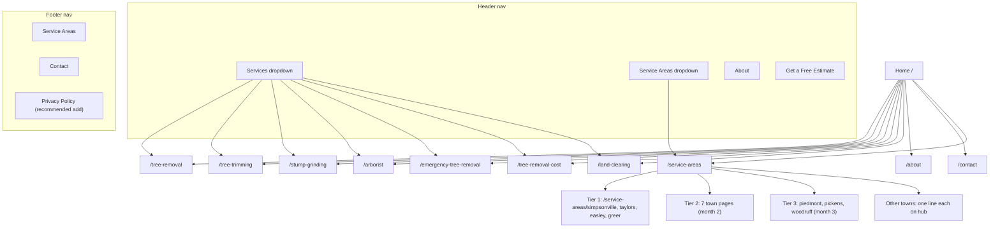

# Site architecture plan: Greenville tree service (rank-and-rent)

**Sources:** `knowledge/research/seo-strategy-greenville-sc.md`, `knowledge/research/playbook.md`, `context/core/business-profile.json`, `context/core/icp.json`, `context/core/voice-dna.json`, `context/core/brand-palette.json`. `playbook.pdf` was not used.
**Status:** Plan only. No live site exists yet.
**Site type:** Local service business. About 25 pages, two levels deep at most. Services are flat at the root. Town pages sit under `/service-areas/`.

---

## 1. Page hierarchy

```
Homepage (/)
├── Tree Removal (/tree-removal)
├── Tree Trimming and Pruning (/tree-trimming)
├── Stump Grinding (/stump-grinding)
├── Arborist Services (/arborist)
├── Emergency Tree Removal (/emergency-tree-removal)
├── Tree Removal Cost (/tree-removal-cost)
├── Land Clearing (/land-clearing)
├── About (/about)
├── Contact (/contact)
└── Service Areas (/service-areas), hub page
    ├── Tier 1, launch: /service-areas/simpsonville, /service-areas/taylors,
    │   /service-areas/easley, /service-areas/greer
    ├── Tier 2, month 2: /service-areas/mauldin, /service-areas/fountain-inn,
    │   /service-areas/travelers-rest, /service-areas/five-forks,
    │   /service-areas/powdersville, /service-areas/berea,
    │   /service-areas/wade-hampton
    └── Tier 3, month 3: /service-areas/piedmont, /service-areas/pickens,
        /service-areas/woodruff
```

The hub also lists every other nearby town with one or two lines each, so those towns do not need their own pages.

## 2. Visual sitemap



## 3. URL map

| Page | URL | Parent | Nav location | Priority | Build |
|---|---|---|---|---|---|
| Home | `/` | none | Logo | High | Launch |
| Tree removal | `/tree-removal` | Home | Services | High | Launch |
| Tree trimming | `/tree-trimming` | Home | Services | High | Launch |
| Stump grinding | `/stump-grinding` | Home | Services | High | Launch |
| Arborist | `/arborist` | Home | Services | Medium | Launch |
| Emergency removal | `/emergency-tree-removal` | Home | Services, utility bar phone | High | Launch |
| Removal cost | `/tree-removal-cost` | Home | Services, footer | High | Launch |
| Land clearing | `/land-clearing` | Home | Services | Low | Launch |
| About | `/about` | Home | Header, footer | Medium | Launch |
| Contact | `/contact` | Home | CTA, footer | High | Launch |
| Service areas hub | `/service-areas` | Home | Service Areas, footer | Medium | Launch |
| Simpsonville | `/service-areas/simpsonville` | Service Areas | Service Areas dropdown | High | Launch |
| Taylors | `/service-areas/taylors` | Service Areas | Service Areas dropdown | High | Launch |
| Easley | `/service-areas/easley` | Service Areas | Service Areas dropdown | High | Launch |
| Greer | `/service-areas/greer` | Service Areas | Service Areas dropdown | High | Launch |
| Mauldin | `/service-areas/mauldin` | Service Areas | Hub, footer | Medium | Month 2 |
| Fountain Inn | `/service-areas/fountain-inn` | Service Areas | Hub | Medium | Month 2 |
| Travelers Rest | `/service-areas/travelers-rest` | Service Areas | Hub | Medium | Month 2 |
| Five Forks | `/service-areas/five-forks` | Service Areas | Hub | Low | Month 2 |
| Powdersville | `/service-areas/powdersville` | Service Areas | Hub | Low | Month 2 |
| Berea | `/service-areas/berea` | Service Areas | Hub | Low | Month 2 |
| Wade Hampton | `/service-areas/wade-hampton` | Service Areas | Hub | Low | Month 2 |
| Piedmont | `/service-areas/piedmont` | Service Areas | Hub | Low | Month 3 |
| Pickens | `/service-areas/pickens` | Service Areas | Hub | Low | Month 3 |
| Woodruff | `/service-areas/woodruff` | Service Areas | Hub | Low | Month 3 |

Launch is 15 pages: the 10 core pages, the hub, and four tier 1 towns. Month two brings the total to 22, and month three to 25.

The playbook scheduled the hub for month three. It moves to launch here because every town page now sits under it, so the parent page has to exist when the first town goes live. At launch it lists only the four tier 1 towns. The other towns are added as their pages are published.

### URL structure decision

**Services are flat.** There is no `/services/` folder and no `/services/[service-type]` pattern.
- The playbook assigns each head term a flat URL (`/tree-removal`, `/stump-grinding`, and so on). Changing them would break that mapping.
- The home page already targets the main term and links to every service, so a `/services/` index would be a thin page competing with it.

**Towns are nested under `/service-areas/[city]`.**
- Towns are one page type with up to 14 pages. Grouping them gives a real parent page, `/service-areas`, which acts as the hub.
- Breadcrumbs now mirror the URL: `Home > Service Areas > Simpsonville`.
- The hub is renamed from `/areas-we-serve` to `/service-areas`, so the parent segment and the hub are one page.

**Tradeoff.** The URL no longer places the town name at the root (`/simpsonville`). The town name is still in the slug, the H1, and the title tag. The playbook and `seo-strategy-greenville-sc.md` still show the old root-level URLs and need updating to match.

## 4. Navigation spec

**Header (4 top-level items):**
1. Logo, linking to `/`
2. **Services** dropdown: Tree Removal, Tree Trimming, Stump Grinding, Arborist, Emergency Removal, Removal Cost, Land Clearing
3. **Service Areas** dropdown: the four tier 1 towns, then "All service areas" linking to `/service-areas`. List only published towns.
4. About
5. CTA buttons: **Call Now** and **Get a Free Estimate**, both burnt orange (CTA buttons only, per the palette rule)

**Utility bar above the header:** storm-damage line with the 864 phone number, linking to `/emergency-tree-removal`.

**Mobile:** hamburger menu with a sticky Call Now button at the bottom of the screen.

**Footer, four columns:**
- **Services:** all seven service pages
- **Service Areas:** tier 1 towns, then `/service-areas`
- **Company:** About, Contact, Free Estimate
- **Legal:** Privacy Policy (recommended add, not in the original page list)

**Breadcrumbs:**
- Service pages: `Home > Tree Removal`
- Hub: `Home > Service Areas`
- Town pages: `Home > Service Areas > Simpsonville`, with each segment linked except the current page

## 5. Internal linking plan

**Hub pages:**
- **Home** links to all four core services, emergency, cost, contact, and the four tier 1 towns.
- **`/tree-removal`** is the secondary hub for `/stump-grinding`, `/emergency-tree-removal`, `/tree-removal-cost`, and a crane removal section.
- **`/service-areas`** links to every town page. Every town page links back to it through the breadcrumb and an "All service areas" link.

**Service-to-service links:**
- Removal ↔ Emergency, Removal ↔ Cost, Removal → Stump Grinding, Removal → Land Clearing
- Trimming ↔ Arborist, Trimming → Removal
- Arborist → Removal and Trimming
- Stump Grinding → Removal, Stump Grinding → Land Clearing
- Emergency → Removal, Emergency → Contact
- Cost → each service page

**Town pages:**
- Each town links to the three core services and the emergency page.
- Each town links to two nearby towns (for example, Mauldin → Simpsonville, Fountain Inn → Simpsonville, Berea → Greer).
- Each town links back to `/service-areas`.

**Anchor text:** name the service and place, for example "tree removal in Simpsonville." Avoid "click here" and "learn more."

**Orphan audit at build time:** every page must be in the sitemap and linked from the header, footer, or a hub page.

## 6. Keyword cannibalization map

| Keyword | Owner | Watch for |
|---|---|---|
| tree service greenville sc, tree company | Home | Keep these off service pages |
| tree trimming | `/tree-trimming` | The SEO strategy currently lists "tree trimming" in the home cluster. Move it to `/tree-trimming`. |
| tree pruning greenville sc | `/tree-trimming` | None |
| tree removal greenville sc | `/tree-removal` | Do not title this page with a town name |
| tree removal simpsonville sc | `/service-areas/simpsonville` | Lead with removal on this page, not on `/tree-removal` |
| tree service taylors / easley / greer sc | Each town page | None |
| emergency tree removal (no measured volume) | `/emergency-tree-removal` | Keep its title distinct from `/tree-removal` |
| tree service (generic, area terms) | `/service-areas` hub | Keep the hub focused on coverage, not on a specific town keyword |

## 7. Decisions needed

1. **Brand and entity.** `business-profile.json` says "Greenville Tree & Stump," but the playbook leaves the brand open. Schema and citations depend on which business does the work. Confirm the name, the entity holding the license, and whether the site uses that name.
2. **Credentials.** Confirm "licensed," "insured," and "ISA certified" are true before they appear on any page.
3. **Commercial and HOA service.** Included in the business profile and persona 2, but no page is planned and there is no keyword data. Recommend `/commercial-tree-service` in month three only after keyword research, or drop it from the persona.
4. **Crane removal.** Recommend a section on `/tree-removal`, not its own page.
5. **Free downloads.** Storm checklist and tree care guide should be downloads linked from `/emergency-tree-removal` and `/tree-trimming`, not separate URLs.
6. **Privacy page.** Add `/privacy-policy` to the footer. The lead forms collect contact details.
7. **Listicle.** Keep on hold. Set selection criteria before reserving a URL.
8. **Trailing slash.** Pick one convention and set it in the Astro config. Recommend no trailing slash.
9. **Cost page sourcing.** Persona budget ranges are labeled "market benchmark, source not specified." Cite sources on the cost page.
10. **Services hub.** Services stay flat. If the owner wants a `/services/` index with `/services/[service-type]` pages, that changes the URL map, sitemap, nav, and breadcrumbs, and should be decided before launch.

## 8. Build order

1. Build the 10 core pages, the `/service-areas` hub, and the four tier 1 town pages, with the header, footer, and Services and Service Areas dropdowns.
2. Set up the sitemap and submit it to Search Console at launch.
3. Month two: add tier 2 towns, and add each to the hub and dropdown when live.
4. Month three: add tier 3 towns.

## Open items in source files

- `seo-strategy-greenville-sc.md` section 2 lists "tree trimming" in the home cluster. It should move to `/tree-trimming`.
- `seo-strategy-greenville-sc.md` and `playbook.md` use root-level town URLs (`/simpsonville`, `/taylors`) and `/areas-we-serve`. These should become `/service-areas/[city]` and `/service-areas` to match this plan.
