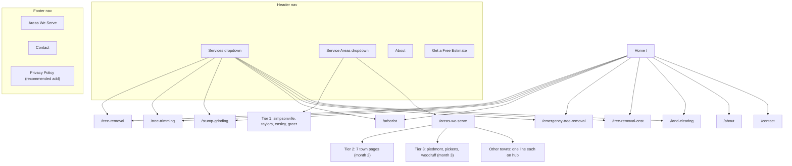

# Site architecture plan: Greenville tree service (rank-and-rent)

**Sources:** `knowledge/research/seo-strategy-greenville-sc.md`, `knowledge/research/playbook.md`, `context/core/business-profile.json`, `context/core/icp.json`, `context/core/voice-dna.json`, `context/core/brand-palette.json`. `playbook.pdf` was not used.
**Status:** Plan only. No live site exists yet.
**Site type:** Local service business. Flat two-level structure, about 25 pages. Every page sits one click from home.

---

## 1. Page hierarchy

```
Homepage (/)
├── Tree Removal (/tree-removal)
├── Tree Trimming and Pruning (/tree-trimming)
├── Stump Grinding (/stump-grinding)
├── Arborist Services (/arborist)
├── Emergency Tree Removal (/emergency-tree-removal)
├── Tree Removal Cost (/tree-removal-cost)
├── Land Clearing (/land-clearing)
├── About (/about)
├── Contact (/contact)
├── Service area pages (flat, one level under home)
│   ├── Tier 1, launch: /simpsonville, /taylors, /easley, /greer
│   ├── Tier 2, month 2: /mauldin, /fountain-inn, /travelers-rest,
│   │   /five-forks, /powdersville, /berea, /wade-hampton
│   └── Tier 3, month 3: /piedmont, /pickens, /woodruff
└── Areas We Serve (/areas-we-serve), hub for all other towns
```

## 2. Visual sitemap



## 3. URL map

| Page | URL | Parent | Nav location | Priority | Build |
|---|---|---|---|---|---|
| Home | `/` | none | Logo | High | Launch |
| Tree removal | `/tree-removal` | Home | Services | High | Launch |
| Tree trimming | `/tree-trimming` | Home | Services | High | Launch |
| Stump grinding | `/stump-grinding` | Home | Services | High | Launch |
| Arborist | `/arborist` | Home | Services | Medium | Launch |
| Emergency removal | `/emergency-tree-removal` | Home | Services, utility bar phone | High | Launch |
| Removal cost | `/tree-removal-cost` | Home | Services, footer | High | Launch |
| Land clearing | `/land-clearing` | Home | Services | Low | Launch |
| About | `/about` | Home | Header, footer | Medium | Launch |
| Contact | `/contact` | Home | CTA, footer | High | Launch |
| Simpsonville | `/simpsonville` | Areas hub | Service Areas | High | Launch |
| Taylors | `/taylors` | Areas hub | Service Areas | High | Launch |
| Easley | `/easley` | Areas hub | Service Areas | High | Launch |
| Greer | `/greer` | Areas hub | Service Areas | High | Launch |
| Mauldin | `/mauldin` | Areas hub | Areas hub, footer | Medium | Month 2 |
| Fountain Inn | `/fountain-inn` | Areas hub | Areas hub | Medium | Month 2 |
| Travelers Rest | `/travelers-rest` | Areas hub | Areas hub | Medium | Month 2 |
| Five Forks | `/five-forks` | Areas hub | Areas hub | Low | Month 2 |
| Powdersville | `/powdersville` | Areas hub | Areas hub | Low | Month 2 |
| Berea | `/berea` | Areas hub | Areas hub | Low | Month 2 |
| Wade Hampton | `/wade-hampton` | Areas hub | Areas hub | Low | Month 2 |
| Piedmont | `/piedmont` | Areas hub | Areas hub | Low | Month 3 |
| Pickens | `/pickens` | Areas hub | Areas hub | Low | Month 3 |
| Woodruff | `/woodruff` | Areas hub | Areas hub | Low | Month 3 |
| Areas we serve | `/areas-we-serve` | Home | Footer, Service Areas | Medium | Month 3 |

Launch is 14 pages, month two brings the total to 21, and month three to 25.

### URL structure decision

All service and town pages are flat, one level under the root. There is no `/services/` folder and no `/services/[service-type]` pattern.

Reasons:
- **Keyword mapping.** The playbook assigns each head term a flat URL (`/tree-removal`, `/stump-grinding`, and so on). Changing them would break that mapping.
- **Site size.** At about 25 pages, a two-level flat structure is enough. A `/services/` layer adds depth without adding findability.
- **Consistency.** Town pages are also at the root (`/simpsonville`). A services folder would put one page type under a folder and the other at the root.
- **No parent page needed.** The home page already targets the main term and links to every service. A `/services/` index would be a thin page competing with it.

Tradeoff: breadcrumbs stay short (`Home > Tree Removal`) and do not show a deeper path.

Alternative if the owner wants a services hub: add `/services/` as an index page and move the seven service pages under it. That changes the URL map, the sitemap, the header and footer links, and the breadcrumbs. Keyword mapping stays the same, but the URLs change, so the change should be made before launch.

## 4. Navigation spec

**Header (4 top-level items):**
1. Logo, linking to `/`
2. **Services** dropdown: Tree Removal, Tree Trimming, Stump Grinding, Arborist, Emergency Removal, Removal Cost, Land Clearing
3. **Service Areas** dropdown: the four tier 1 towns, then "All areas" linking to `/areas-we-serve`. List only published towns.
4. About
5. CTA buttons: **Call Now** and **Get a Free Estimate**, both burnt orange (CTA buttons only, per the palette rule)

**Utility bar above the header:** storm-damage line with the 864 phone number, linking to `/emergency-tree-removal`.

**Mobile:** hamburger menu with a sticky Call Now button at the bottom of the screen.

**Footer, four columns:**
- **Services:** all seven service pages
- **Service Areas:** tier 1 towns, then `/areas-we-serve`
- **Company:** About, Contact, Free Estimate
- **Legal:** Privacy Policy (recommended add, not in the original page list)

**Breadcrumbs:**
- Service pages: `Home > Tree Removal`
- Town pages: `Home > Simpsonville`. The flat URL has no `/service-areas/` segment, so a longer breadcrumb would not mirror the URL.

## 5. Internal linking plan

**Hub pages:**
- **Home** links to all four core services, emergency, cost, contact, and the four tier 1 towns.
- **`/tree-removal`** is the secondary hub for `/stump-grinding`, `/emergency-tree-removal`, `/tree-removal-cost`, and a crane removal section.
- **`/areas-we-serve`** links to every town page. Every town page links back to it.

**Service-to-service links:**
- Removal ↔ Emergency, Removal ↔ Cost, Removal → Stump Grinding, Removal → Land Clearing
- Trimming ↔ Arborist, Trimming → Removal
- Arborist → Removal and Trimming
- Stump Grinding → Removal, Stump Grinding → Land Clearing
- Emergency → Removal, Emergency → Contact
- Cost → each service page

**Town pages:**
- Each town links to the three core services and the emergency page.
- Each town links to two nearby towns (for example, Mauldin → Simpsonville, Fountain Inn → Simpsonville, Berea → Greer).
- Each town links back to `/areas-we-serve`.

**Anchor text:** name the service and place, for example "tree removal in Simpsonville." Avoid "click here" and "learn more."

**Orphan audit at build time:** every page must be in the sitemap and linked from the header, footer, or a hub page.

## 6. Keyword cannibalization map

| Keyword | Owner | Watch for |
|---|---|---|
| tree service greenville sc, tree company | Home | Keep these off service pages |
| tree trimming | `/tree-trimming` | The SEO strategy currently lists "tree trimming" in the home cluster. Move it to `/tree-trimming`. |
| tree pruning greenville sc | `/tree-trimming` | None |
| tree removal greenville sc | `/tree-removal` | Do not title this page with a town name |
| tree removal simpsonville sc | `/simpsonville` | Lead with removal on this page, not on `/tree-removal` |
| tree service taylors / easley / greer sc | Each town page | None |
| emergency tree removal (no measured volume) | `/emergency-tree-removal` | Keep its title distinct from `/tree-removal` |

## 7. Decisions needed

1. **Brand and entity.** `business-profile.json` says "Greenville Tree & Stump," but the playbook leaves the brand open. Schema and citations depend on which business does the work. Confirm the name, the entity holding the license, and whether the site uses that name.
2. **Credentials.** Confirm "licensed," "insured," and "ISA certified" are true before they appear on any page.
3. **Commercial and HOA service.** Included in the business profile and persona 2, but no page is planned and there is no keyword data. Recommend `/commercial-tree-service` in month three only after keyword research, or drop it from the persona.
4. **Crane removal.** Recommend a section on `/tree-removal`, not its own page.
5. **Free downloads.** Storm checklist and tree care guide should be downloads linked from `/emergency-tree-removal` and `/tree-trimming`, not separate URLs.
6. **Privacy page.** Add `/privacy-policy` to the footer. The lead forms collect contact details.
7. **Listicle.** Keep on hold. Set selection criteria before reserving a URL.
8. **Trailing slash.** Pick one convention and set it in the Astro config. Recommend no trailing slash.
9. **Cost page sourcing.** Persona budget ranges are labeled "market benchmark, source not specified." Cite sources on the cost page.

## 8. Build order

1. Build the 10 core pages and the four tier 1 town pages, with the header, footer, and Services and Service Areas dropdowns.
2. Set up the sitemap and submit it to Search Console at launch.
3. Month two: add tier 2 towns, and add each to the Areas hub and dropdown when live.
4. Month three: add tier 3 towns and `/areas-we-serve`.

## Open items in source files

- `seo-strategy-greenville-sc.md` section 2 lists "tree trimming" in the home cluster. It should move to `/tree-trimming`.
