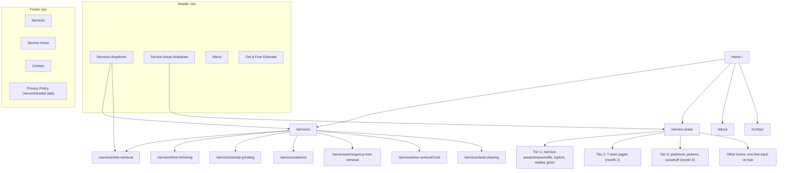

# Site architecture plan: Greenville tree service (rank-and-rent)

**Sources:** `knowledge/research/seo-strategy-greenville-sc.md`, `knowledge/research/playbook.md`, `context/core/business-profile.json`, `context/core/icp.json`, `context/core/voice-dna.json`, `context/core/brand-palette.json`. `playbook.pdf` was not used.
**Status:** Plan only. No live site exists yet.
**Site type:** Local service business. About 26 pages, two levels deep at most. Services live under `/services/`. Towns live under `/service-areas/`.

---

## 1. Page hierarchy

```
Homepage (/)
├── Services (/services), hub page
│   ├── Tree Removal (/services/tree-removal)
│   ├── Tree Trimming and Pruning (/services/tree-trimming)
│   ├── Stump Grinding (/services/stump-grinding)
│   ├── Arborist Services (/services/arborist)
│   ├── Emergency Tree Removal (/services/emergency-tree-removal)
│   ├── Tree Removal Cost (/services/tree-removal-cost)
│   └── Land Clearing (/services/land-clearing)
├── Service Areas (/service-areas), hub page
│   ├── Tier 1, launch: /service-areas/simpsonville, /service-areas/taylors,
│   │   /service-areas/easley, /service-areas/greer
│   ├── Tier 2, month 2: /service-areas/mauldin, /service-areas/fountain-inn,
│   │   /service-areas/travelers-rest, /service-areas/five-forks,
│   │   /service-areas/powdersville, /service-areas/berea,
│   │   /service-areas/wade-hampton
│   └── Tier 3, month 3: /service-areas/piedmont, /service-areas/pickens,
│       /service-areas/woodruff
├── About (/about)
└── Contact (/contact)
```

The Service Areas hub also lists every other nearby town with one or two lines each, so those towns do not need their own pages.

## 2. Visual sitemap



## 3. URL map

| Page | URL | Parent | Nav location | Priority | Build |
|---|---|---|---|---|---|
| Home | `/` | none | Logo | High | Launch |
| Services hub | `/services` | Home | Services dropdown, footer | Medium | Launch |
| Tree removal | `/services/tree-removal` | Services | Services dropdown | High | Launch |
| Tree trimming | `/services/tree-trimming` | Services | Services dropdown | High | Launch |
| Stump grinding | `/services/stump-grinding` | Services | Services dropdown | High | Launch |
| Arborist | `/services/arborist` | Services | Services dropdown | Medium | Launch |
| Emergency removal | `/services/emergency-tree-removal` | Services | Services dropdown, utility bar phone | High | Launch |
| Removal cost | `/services/tree-removal-cost` | Services | Services dropdown, footer | High | Launch |
| Land clearing | `/services/land-clearing` | Services | Services dropdown | Low | Launch |
| Service areas hub | `/service-areas` | Home | Service Areas dropdown, footer | Medium | Launch |
| Simpsonville | `/service-areas/simpsonville` | Service Areas | Service Areas dropdown | High | Launch |
| Taylors | `/service-areas/taylors` | Service Areas | Service Areas dropdown | High | Launch |
| Easley | `/service-areas/easley` | Service Areas | Service Areas dropdown | High | Launch |
| Greer | `/service-areas/greer` | Service Areas | Service Areas dropdown | High | Launch |
| About | `/about` | Home | Header, footer | Medium | Launch |
| Contact | `/contact` | Home | CTA, footer | High | Launch |
| Mauldin | `/service-areas/mauldin` | Service Areas | Hub, footer | Medium | Month 2 |
| Fountain Inn | `/service-areas/fountain-inn` | Service Areas | Hub | Medium | Month 2 |
| Travelers Rest | `/service-areas/travelers-rest` | Service Areas | Hub | Medium | Month 2 |
| Five Forks | `/service-areas/five-forks` | Service Areas | Hub | Low | Month 2 |
| Powdersville | `/service-areas/powdersville` | Service Areas | Hub | Low | Month 2 |
| Berea | `/service-areas/berea` | Service Areas | Hub | Low | Month 2 |
| Wade Hampton | `/service-areas/wade-hampton` | Service Areas | Hub | Low | Month 2 |
| Piedmont | `/service-areas/piedmont` | Service Areas | Hub | Low | Month 3 |
| Pickens | `/service-areas/pickens` | Service Areas | Hub | Low | Month 3 |
| Woodruff | `/service-areas/woodruff` | Service Areas | Hub | Low | Month 3 |

Launch is 16 pages: home, the Services hub and seven service pages, the Service Areas hub and four tier 1 towns, About, and Contact. Month two brings the total to 23, and month three to 26.

The playbook planned 25 pages. The extra page is the new `/services` hub. The Service Areas hub also moves from month three to launch, because every town page sits under it. At launch it lists only the four tier 1 towns. The other towns are added as their pages are published.

### URL structure decision

**Services:** `/services/[service-type]`. **Towns:** `/service-areas/[city]`. Both page types follow one pattern, each with a hub page as the parent.

- Breadcrumbs mirror the URL for every page: `Home > Services > Tree Removal` and `Home > Service Areas > Simpsonville`.
- Each hub gives crawlers and visitors one page that lists the whole group.
- The slug still carries the keyword (`tree-removal`, `stump-grinding`, the town name).

**Tradeoffs.**
- Every service URL is one segment longer than the playbook's flat URLs (`/tree-removal`). The playbook and `seo-strategy-greenville-sc.md` still show the old URLs and need updating.
- `/services` is a new page. It must be a real overview with a short description and link for each service, not a thin list. The home page owns "tree service greenville sc," so the hub should not target that phrase.
- `/services/tree-removal-cost` is informational, not a service. It sits under `/services/` so the cost page is next to the removal page it supports. It could also move to the root if that reads awkwardly.

## 4. Navigation spec

**Header (4 top-level items):**
1. Logo, linking to `/`
2. **Services** dropdown: Tree Removal, Tree Trimming, Stump Grinding, Arborist, Emergency Removal, Removal Cost, Land Clearing, then "All services" linking to `/services`
3. **Service Areas** dropdown: the four tier 1 towns, then "All service areas" linking to `/service-areas`. List only published towns.
4. About
5. CTA buttons: **Call Now** and **Get a Free Estimate**, both burnt orange (CTA buttons only, per the palette rule)

**Utility bar above the header:** storm-damage line with the 864 phone number, linking to `/services/emergency-tree-removal`.

**Mobile:** hamburger menu with a sticky Call Now button at the bottom of the screen.

**Footer, four columns:**
- **Services:** all seven service pages and `/services`
- **Service Areas:** tier 1 towns, then `/service-areas`
- **Company:** About, Contact, Free Estimate
- **Legal:** Privacy Policy (recommended add, not in the original page list)

**Breadcrumbs:**
- Service pages: `Home > Services > Tree Removal`
- Services hub: `Home > Services`
- Service Areas hub: `Home > Service Areas`
- Town pages: `Home > Service Areas > Simpsonville`

Each segment is linked except the current page.

## 5. Internal linking plan

**Hub pages:**
- **Home** links to `/services`, the four core service pages, emergency, cost, `/service-areas`, the four tier 1 towns, and contact.
- **`/services`** links to all seven service pages. Every service page links back to it through the breadcrumb.
- **`/services/tree-removal`** is the secondary hub for stump grinding, emergency, cost, and a crane removal section.
- **`/service-areas`** links to every town page. Every town page links back to it through the breadcrumb and an "All service areas" link.

**Service-to-service links:**
- Removal ↔ Emergency, Removal ↔ Cost, Removal → Stump Grinding, Removal → Land Clearing
- Trimming ↔ Arborist, Trimming → Removal
- Arborist → Removal and Trimming
- Stump Grinding → Removal, Stump Grinding → Land Clearing
- Emergency → Removal, Emergency → Contact
- Cost → each service page

**Town pages:**
- Each town links to the three core services and the emergency page.
- Each town links to two nearby towns (for example, Mauldin → Simpsonville, Fountain Inn → Simpsonville, Berea → Greer).
- Each town links back to `/service-areas`.

**Anchor text:** name the service and place, for example "tree removal in Simpsonville." Avoid "click here" and "learn more."

**Orphan audit at build time:** every page must be in the sitemap and linked from the header, footer, or a hub page.

## 6. Keyword cannibalization map

| Keyword | Owner | Watch for |
|---|---|---|
| tree service greenville sc, tree company | Home | Keep these off the `/services` hub and service pages |
| tree trimming | `/services/tree-trimming` | The SEO strategy currently lists "tree trimming" in the home cluster. Move it to this page. |
| tree pruning greenville sc | `/services/tree-trimming` | None |
| tree removal greenville sc | `/services/tree-removal` | Do not title this page with a town name |
| tree removal simpsonville sc | `/service-areas/simpsonville` | Lead with removal on this page, not on `/services/tree-removal` |
| tree service taylors / easley / greer sc | Each town page | None |
| emergency tree removal (no measured volume) | `/services/emergency-tree-removal` | Keep its title distinct from `/services/tree-removal` |
| tree services (generic list intent) | `/services` hub | Overview only, not a competing home page |
| coverage and area terms | `/service-areas` hub | Focus on coverage, not on a specific town keyword |

## 7. Decisions needed

1. **Brand and entity.** `business-profile.json` says "Greenville Tree & Stump," but the playbook leaves the brand open. Schema and citations depend on which business does the work. Confirm the name, the entity holding the license, and whether the site uses that name.
2. **Credentials.** Confirm "licensed," "insured," and "ISA certified" are true before they appear on any page.
3. **Commercial and HOA service.** Included in the business profile and persona 2, but no page is planned and there is no keyword data. Recommend `/services/commercial-tree-service` in month three only after keyword research, or drop it from the persona.
4. **Crane removal.** Recommend a section on `/services/tree-removal`, not its own page.
5. **Free downloads.** Storm checklist and tree care guide should be downloads linked from the emergency and trimming pages, not separate URLs.
6. **Privacy page.** Add `/privacy-policy` to the footer. The lead forms collect contact details.
7. **Listicle.** Keep on hold. Set selection criteria before reserving a URL.
8. **Trailing slash.** Pick one convention and set it in the Astro config. Recommend no trailing slash.
9. **Cost page sourcing and location.** Persona budget ranges are labeled "market benchmark, source not specified." Cite sources on the cost page. Confirm it stays under `/services/`.

## 8. Build order

1. Build the home page, the `/services` hub and seven service pages, About, Contact, the `/service-areas` hub, and the four tier 1 town pages, with the header, footer, and both dropdowns.
2. Set up the sitemap and submit it to Search Console at launch.
3. Month two: add tier 2 towns, and add each to the hub and dropdown when live.
4. Month three: add tier 3 towns.

## Open items in source files

- `seo-strategy-greenville-sc.md` section 2 lists "tree trimming" in the home cluster. It should move to `/services/tree-trimming`.
- `seo-strategy-greenville-sc.md` and `playbook.md` use root-level service and town URLs (`/tree-removal`, `/simpsonville`) and `/areas-we-serve`. These should become `/services/[service-type]`, `/service-areas/[city]`, and `/service-areas` to match this plan.
